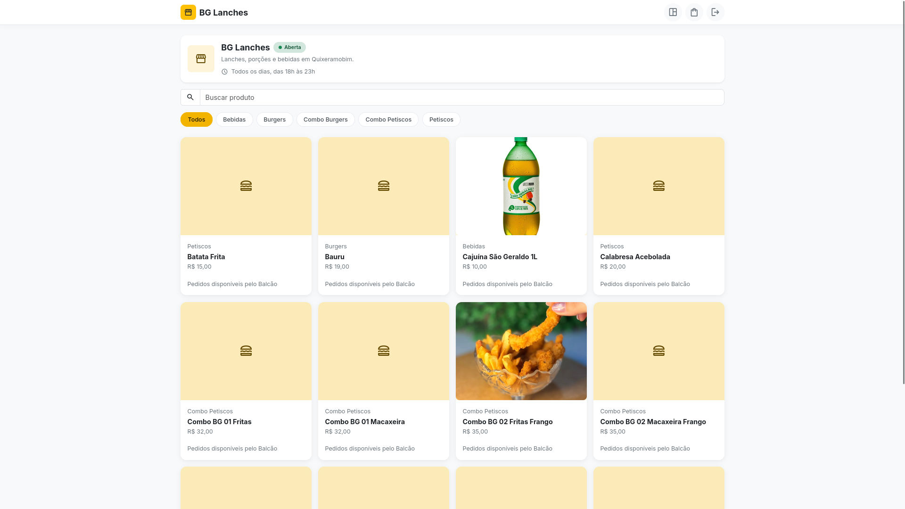
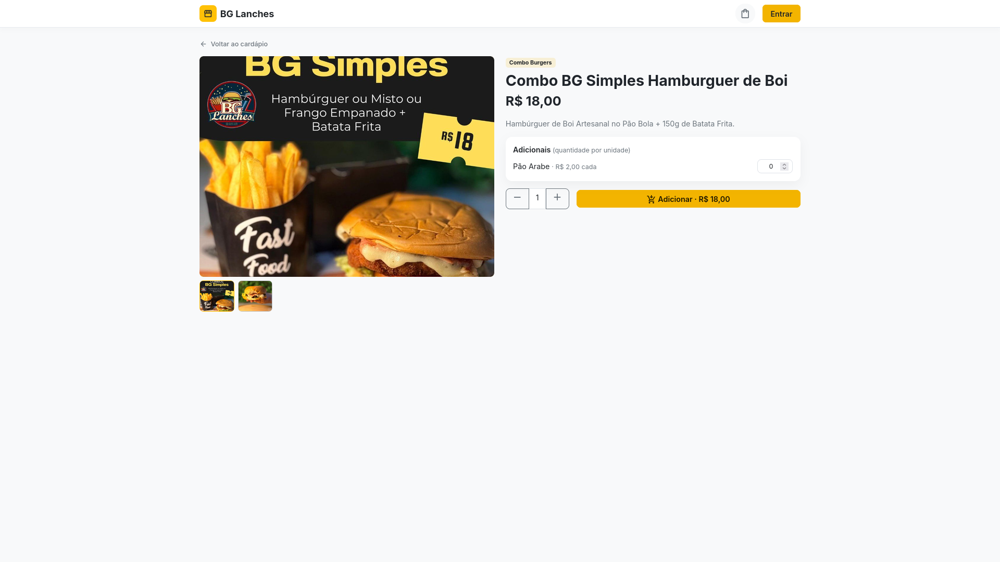
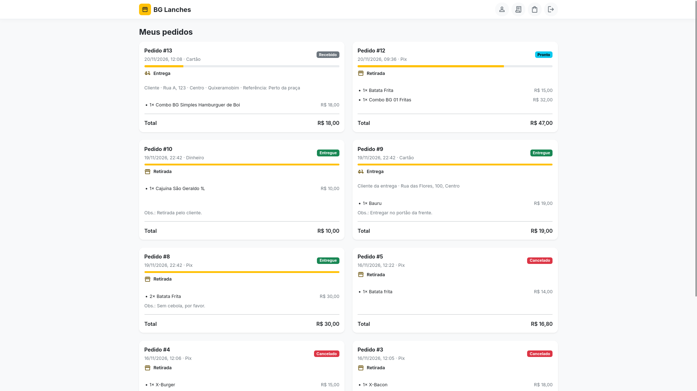
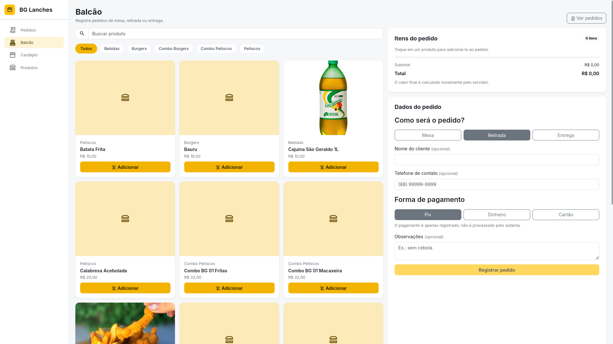
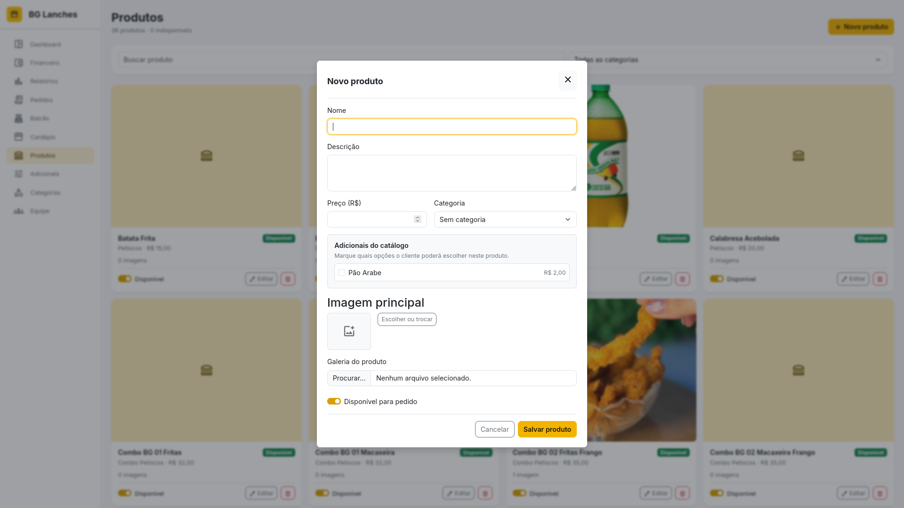
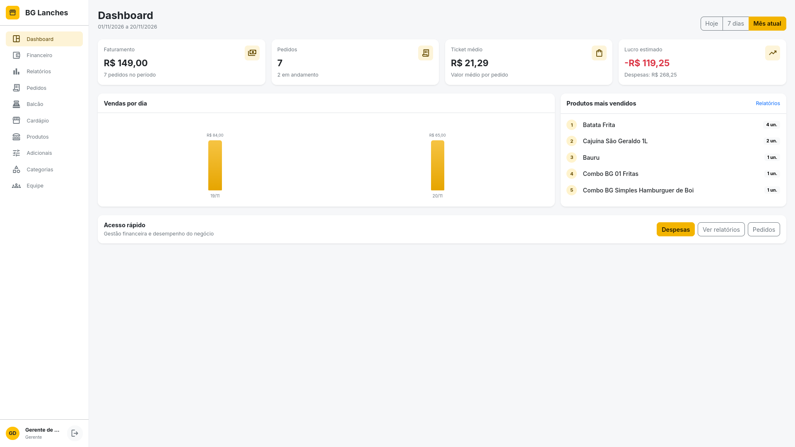

# :checkered_flag: Caderneta

**Comanda digital, pedidos e gestão para pequenas lanchonetes.** Aplicação web desenvolvida com a BG Lanches, em Quixeramobim-CE. Clientes consultam o cardápio, montam pedidos e acompanham o andamento; atendentes organizam os pedidos; gerentes controlam catálogo, equipe e financeiro.

> A proposta do projeto está em [`PROPOSTA.md`](PROPOSTA.md) e a documentação de entrega final em [`ENTREGA.md`](ENTREGA.md).

<p align="center">

  
  
  
</p>

## Sobre o projeto

A Caderneta reúne em um único sistema o cardápio digital, os pedidos online e de balcão, o acompanhamento da operação e ferramentas básicas de gestão financeira. O projeto foi pensado para uma lanchonete de pequeno porte e prioriza execução local para demonstração e avaliação.

## Funcionalidades

- **Visitantes:** consultam informações da loja e navegam pelo cardápio, com categorias e busca.

- **Clientes:** criam uma conta, gerenciam endereços, montam o carrinho, fazem pedidos para retirada ou entrega e acompanham os próprios pedidos.

- **Atendentes:** acompanham e atualizam pedidos, registram vendas de balcão e alteram a disponibilidade dos produtos.

- **Gerentes:** administram produtos, categorias, adicionais e equipe; registram despesas e consultam dashboard e relatórios com exportação CSV e impressão.

- **Adicionais por produto:** o gerente associa opções ao catálogo; o sistema valida a seleção e recalcula o valor do pedido.

## Capturas da aplicação

<div align="center">
<table>
  <tr>
    <td align="center">
<sub>Cardápio público</sub></td>
    <td align="center">
<sub>Produto com adicionais</sub></td>
  </tr>
  <tr>
    <td align="center">
<sub>Meus pedidos</sub></td>
    <td align="center">
<sub>Balcão e pedidos</sub></td>
  </tr>
  <tr>
    <td align="center">
<sub>Produto e adicionais — gerente</sub></td>
    <td align="center">
<sub>Dashboard — gerente</sub></td>
  </tr>
</table>
</div>


## Como funciona
O servidor Node local entrega o frontend e encaminha as chamadas de API e arquivos enviados ao Strapi. A aplicação usa autenticação JWT e permissões distintas por perfil.

## Tecnologias

- **Frontend:** HTML5, CSS3 e JavaScript puro, com Bootstrap CSS 5.3.8.

- **Backend:** Strapi 5.61.0 e API REST.

- **Banco de dados:** SQLite.

- **Outros:** Node.js, Google Fonts (Inter e Material Symbols), exportação CSV e impressão pelo navegador.

## Executar localmente

O projeto é preparado para rodar na máquina de avaliação. Os pré-requisitos, configuração do `.env`, banco de demonstração e comandos completos estão em [`ENTREGA.md`](ENTREGA.md). Em resumo, são iniciados o Strapi (`npm run develop`, pasta `backend-strapi`) e o frontend (`node servidor.js`, pasta `frontend`); depois, acesse `http://localhost:5500`.

## Estrutura do repositório

```
backend-strapi/         API Strapi, modelos e regras de negócio
frontend/        páginas HTML, estilos e scripts do navegador
docs/screenshots/ capturas reais da aplicação
```

## Documentos do projeto

- [`PROPOSTA.md`](PROPOSTA.md) — objetivo, público-alvo, papéis, funcionalidades e entidades.

- [`ENTREGA.md`](ENTREGA.md) — instalação local, credenciais de demonstração, uso de IA, dificuldades, limitações e tecnologias.
